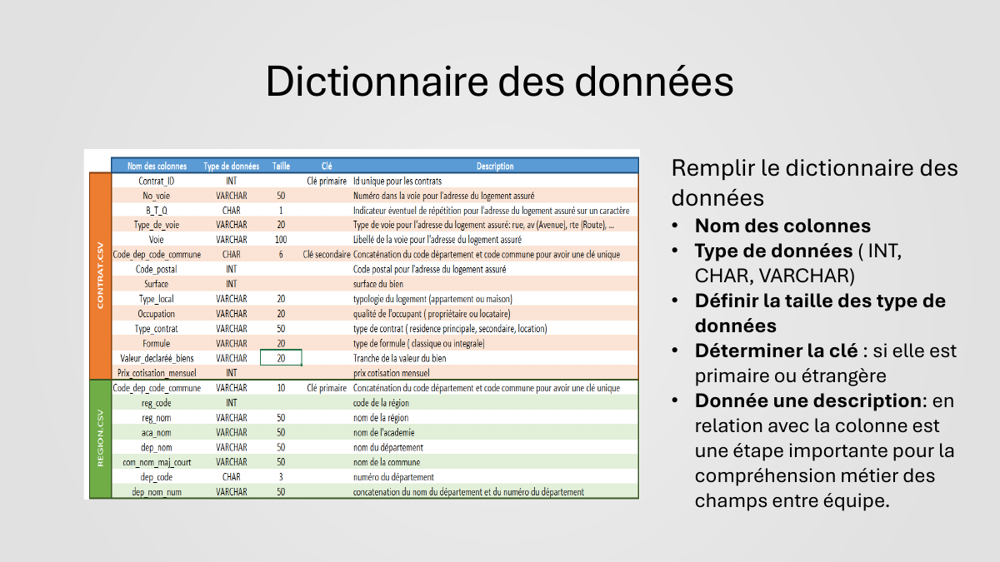
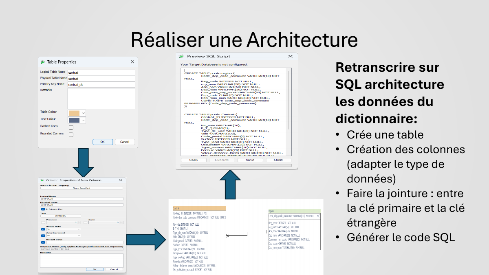
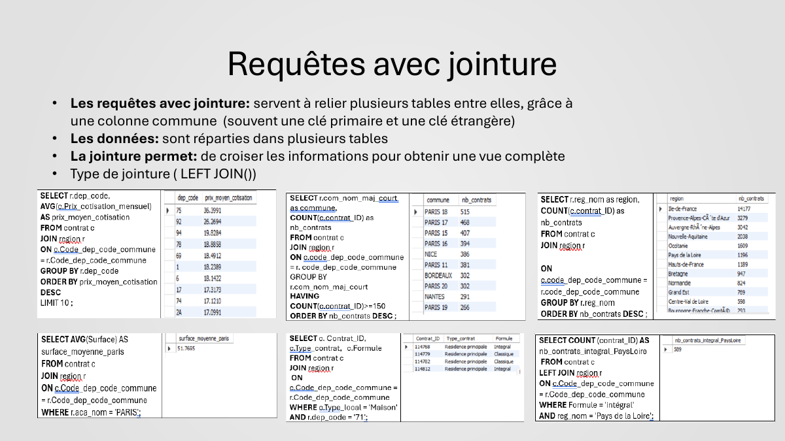

# 🗄️ Requêter une base de données avec SQL

*Projet 3 de la formation **Business Intelligence Analyst** – OpenClassrooms · Projet validé*

## 🎯 Contexte et objectif

Une compagnie d'assurance habitation disposait de ses données sous forme de deux fichiers CSV : les **contrats** (plus de 30 000 lignes) et les **régions / communes** (près de 39 000 lignes).

Ma mission : **construire une base de données relationnelle à partir de ces fichiers, puis l'interroger en SQL** pour répondre aux questions métier (contrats, surfaces, cotisations, répartition géographique).

## 🛠️ Outils et compétences

- **MySQL Workbench** : création de la base, des tables et import des données (encodage UTF-8)
- **Modélisation** : dictionnaire des données, types (INT, CHAR, VARCHAR), contraintes (NULL / NOT NULL), clés primaires et étrangères, schéma relationnel
- **SQL** : `SELECT`, `WHERE`, agrégations (`COUNT`, `SUM`, `AVG`), `GROUP BY`, `ORDER BY`, `HAVING`, jointures (`JOIN`, `LEFT JOIN`)

## 🔎 Démarche

1. **Comprendre les données** : nature de chaque colonne et détection des pièges (nombres stockés en texte, valeurs vides…)
2. **Rédiger le dictionnaire des données** : nom, type, taille, clé et description métier de chaque colonne
3. **Concevoir le schéma relationnel** et générer le code SQL de création des tables
4. **Importer les données** et vérifier le chargement (`SELECT COUNT(*)`)
5. **Écrire 12 requêtes SQL**, des plus simples aux plus complexes (agrégations, jointures, classements)

## 📊 Aperçu

**Dictionnaire des données**

**Schéma relationnel**

**Exemples de requêtes avec jointure**

## 💡 Exemples de questions traitées

- Combien existe-t-il de contrats sur les résidences principales ?
- Quel est le prix moyen de la cotisation mensuelle ?
- Classement des 10 départements où la cotisation moyenne est la plus élevée
- Liste des communes ayant eu au moins 150 contrats
- Nombre de contrats par région

## 📁 Fichiers du projet

| Fichier | Contenu |
|---|---|
| [presentation_methodologie.pdf](presentation_methodologie.pdf) | La méthodologie étape par étape |
| [document_technique.pdf](document_technique.pdf) | Le document technique complet (dictionnaire, schéma, import) |
| [liste_requetes_sql.pdf](liste_requetes_sql.pdf) | Les 12 requêtes SQL et leurs résultats |
| `.docx` | Les versions Word des deux documents (à télécharger) |

---
👩‍💼 **Manal Salhi** – Business Analyst / Data Analyst · [LinkedIn](https://www.linkedin.com/in/manal-salhi-030a692b5/)
